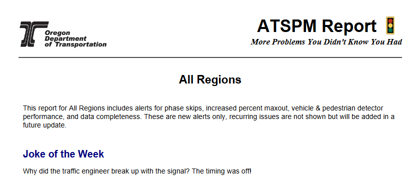

# atspm-report

[](https://github.com/ShawnStrasser/atspm-report/actions/workflows/pr-tests.yml)
[](https://pypi.org/project/atspm-report/)
[](https://codecov.io/gh/ShawnStrasser/atspm-report)
[](https://pypi.org/project/atspm-report/)
[](https://opensource.org/licenses/MIT)

Turns the output tables of the [atspm](https://github.com/ShawnStrasser/atspm) package into per-region PDF reports of **new** traffic signal issues. Repeat alerts are suppressed against history you store between runs, so each report shows what changed, not what is already known.



```bash
pip install atspm-report
```

## What it does

`ReportGenerator(config).generate(...)` takes pandas DataFrames or DuckDB relations, runs the detectors, suppresses repeats, and returns PDFs as `BytesIO` plus the alert tables behind them.

It does **not** fetch data, read or write files, send email, or schedule anything. You supply the inputs, save the PDFs, and persist the returned history for the next run.

## Alert types

| Section | Input | Method |
|---|---|---|
| Phase termination (max-out) | `terminations` | CUSUM on daily percent max-out per phase, kept only if still high at the end of the day (hourly drain) |
| Detector health | `atspm_detector_findings` (+ `detector_counts` for the charts) | Bad and suspect vehicle detectors from [atspm-detector](https://pypi.org/project/atspm-detector/) on raw events, with fault periods; lane closures and timing plan changes as information |
| Pedestrian button health | `atspm_detector_findings` (+ `ped_press_counts` and `pedestrian` for the charts) | Ped buttons stuck on, pressing like a machine or gone silent, from the same table, with charts of presses and walks; ped set-up issues as information |
| Missing data | `has_data` | CUSUM on daily share of missing 15-min bins; shown hour by hour over the last 7 days (when, and how many hours) |
| System outage | `has_data` | Region-wide missing data >= 30% for a day; shown as the hours the region averaged 30% or more missing |
| Phase skip | `phase_wait` | Skips summed per phase over the retention window |
| Clearance intervals | `timeline` | Yellow/red durations vs. each phase's median and absolute minimums |
| Controller alarms | `timeline` | Alarms that fired again today, with six-week totals |
| Emergency vehicle preempt | `timeline` (+ `preempt_events`) | Recent week's calls vs. a negative binomial fitted to each preempt's baseline, gated to fault-sized changes (tripled and +5/day, or silent); chatter, stuck on and missed vehicles from the stored calls |
| Transit Signal Priority | `timeline` + `preempt_events` | Bus priority calls that pulsed a preempt input (5 or more in 7 days): Ran As Preempt, or Priority Interrupted when no preempt ran |
| Rail | `timeline` | The inputs in `preempt_rail_numbers`: long hold, stuck on, and the frequency check |
| Phase / overlap conflicts | `timeline` | Interval overlap of conflicting indications (opt-in) |
| Controller clocks | `timeline` (the stored preempt calls) + coordinates | A signal whose emergency vehicle calls line up with nearby signals' calls a fixed time apart: its clock is off (on by default) |
| Coordination plans | `coordination_agg` (six weeks, with `Pattern`) + coordinates | A signal that, on one kind of day, runs another plan, runs free or changes plans at other hours than the coordinated signals around it (opt-in) |
| Phases ending green too early | `split_failures` + `terminations` | Split failures without max outs: queues left at 15 %+ of greens that gapped out, 2+ hours, on 2 of the last 3 days of the kind (opt-in) |
| Sudden rise in delay | `approach_delay` + `arrival_on_green` (+ `platoon_ratio`) | Delay per vehicle up 5 s and 50 % over the same hours of earlier days of the kind, 3 sd, 4+ hours (opt-in) |
| Rising split failures / falling platoon ratio | `split_failures` / `platoon_ratio` | The max-out method on each phase's daily value; silent until 18 days exist (opt-in) |

Pass only the inputs you have; every argument except `signals` is optional and a missing input just leaves its section out.

## Preempt, TSP and rail

A controller set up for transit signal priority (TSP) logs a bus as TSP events only (check-in 112 to check-out 115) and no preempt call, so normal TSP is never among the preempt calls. A burst of short pulses on a preempt input is a fault: a bus priority signal read as preempt calls (TSP check-ins come with the bursts) or an input chattering (no check-ins). Rail has its own inputs (`preempt_rail_numbers`). Every call gets a `Class`, by episode (calls on one input less than 30 s apart):

| Class | Episode |
|---|---|
| Rail | an input in `preempt_rail_numbers` |
| Emergency Vehicle | any call of 5 s or more (pulses beside it included), or a burst of pulses (more than half the calls under 1.5 s, none over 5 s) on an input that is not a bus input: chatter |
| Bus Ran Preempt | a burst of pulses on a bus input, with a preempt entry (105) |
| TSP | a burst of pulses on a bus input that ran no preempt |
| Unclassified | calls of 1.5 to 5 s, or unclosed, that are neither; checked with emergency vehicle calls |

Each class has its own report section, in this order, before the missing data sections: **Emergency Vehicle Preempt** (frequency, chatter, stuck on, missed vehicles; cascades learned from these calls only), **Transit Signal Priority** (bus calls on a preempt input: Ran As Preempt, which can pass over waiting phases and cut walks, or Priority Interrupted, where each pulse cancels the bus's priority request and starts it again) and **Rail** (long hold, stuck on, frequency). A bus input is one where at least half the bursts since the signal's first check-in on record came with a TSP check-in (112, within 5 s, matched by signal); its earlier bursts are bus calls too. Without `preempt_events`, or at a signal that logs no check-ins, every burst is chatter.

`preempt_false_calls_enabled` (on by default) adds **False Calls** to the emergency vehicle section: an input with 1 or more calls a day at the shortest call length (within 0.3 s of the length only 0.5% of all calls are shorter than), making up at least half of its calls, of which at most 30% were seen at a signal within two miles inside the drive time. A trigger of a moment is held for that shortest length. A vehicle seen for a moment makes such a call too, so some are normal; an input with most of its calls at that length, which no nearby signal sees, is triggering by itself. An input with no nearby signal to check against needs 1.5 or more such calls a day making up at least 80% of its calls. The alert states the calls ("74 of 74 calls in the last 7 days had the same duration, lasting about 5.2 s. This does not represent normal EVP calls."); what other signals saw is told only for the input's linked preempts. An Increase on such an input is told as False Calls, an Increase whose calls nearby signals saw (over 30% of them) is real traffic and is not reported, and the charts shade the usual call lengths (the middle 90% of all calls).

## Coordination plans and clocks

One section, **Coordination Plans and Clocks**, after the rail section, one chart per alert. Signal Focus does not tell these, so its signals stay in the table.

- **Clock** (`coordination_clock_check_enabled`, on by default). An emergency vehicle calls one signal after another within seconds to a minute, and each controller stamps its calls with its own clock. A signal whose calls line up with calls at two or more signals within a mile an hour apart (3 or more calls since then, no longer at the same time, a 1 in 1,000 chance or less) has a clock an hour off, from the clock change it missed when one lies between. Any other offset of 5 minutes or more needs 8 calls and 3 signals. Bus and rail calls are left out. It reads the stored preempt calls, so it runs every report (under half a second for a whole network). Its chart plots each call against the matching call nearby, minutes apart by date.
- **Plan** (`coordination_plan_check_enabled`, off by default). Signals within 1.5 miles that run matching cycles (equal, half or double) at least half the time they are coordinated form a group, learned from the `coordination_agg` you pass: pass six weeks with `Pattern` and `CycleLength` (pairs need about five days; weekend findings need three weekends). A signal this leaves without a group is added to one when it sits between two of its signals, or runs the plan of a signal within half a mile for part of the day; it is judged against that group, and the group's own signals are judged as before (the between rule has its own switch, `coordination_position_check_enabled`, off by default). Each alert carries a `Confidence`: High for a clock alert and for a group member that sits inside its group (between two of its signals) and is out of step for two hours or more in all, while no nearby signal outside the group runs the same cycle; Check otherwise (a signal at an end of its group, or one added to a group). Every alert is told once and then held back; only High ones go on to the Ongoing list, and High ones come first in the table and charts. Pattern 255 is left unjudged, not read as flashing. A sentence never spans hours the group ran a plan and hours it ran free, and a group that ran several plans in the hours is told as a range ("run 100 to 135 s"). Each plan chart shades the hours the alert is about. A run lists `coordination_figures` alerts per region, each with its chart; an alert left over is not filed as told, so it is listed on a later run. A signal with a clock alert gets no plan alert. A signal is told when, on 75% (and at least 3) of its last 10 weekdays, 4 Saturdays or 4 Sundays, it ran something none of its neighbours ran while they agreed on another plan, for 30 minutes or more at the same hours, and the latest such day judged in those hours still showed it: a weekend day plan out of step ("Weekends all day it runs free while the other six run 75 s"), or a plan change early or late ("changes from free to 110 s at 7:30, an hour after the other seven (6:30)"). A difference on weekdays or every day is told too, for review: it may be set up that way or set wrong. A plan that logs cycle length 0 gets the cycle it usually logs. After a gap in a signal's data its plan is not trusted until it records a change or the day ends. Times are as each controller logged them. Its chart: cycle length by time of day, the signal against its group in grey.

With `approach_delay` and `arrival_on_green`, each alert gets an **impact chart** after its own: arrivals on green and delay per vehicle by hour of day on the signal's approaches with advance zones, the days it was out of step (strong line) against the days of the same kind it was not (dashed; its own weekdays, labelled so, when it is wrong on every day of that kind), its group's median on the out-of-step days (grey) and the group's nearest signal on both. Hours out of step are shaded when they are not the whole day; a Clock alert's own stamps are moved to true time and compared before and after the offset began. It is drawn only with 2 days or more on each side and 3 hours or more with 20 arrivals an hour on both lines, and when the signal or the nearest one is worse by 5 points of arrivals on green or 1.5 s of delay; otherwise there is no chart.

## Signal Focus

Each report opens with the signals worst off across more than one area: at most 3 a report (`signal_focus_signals`, `0` leaves the section out; the All Regions report takes the top 3 of all regions, each region's report its own top 3), one at a time, each with a subtitle, a table of problem type and measured problems, and its charts in the table's order. The score counts new problems only, weighted to the most recent day of data; missing data never counts. The bar is set for one to three signals over all regions on an ordinary day, so many region reports have none; a day when many signals fail at once has more, three a report. A signal selected there leaves every other table and chart of that report.

The score counts new alerts only. Repeats that suppression held back add nothing, but once a signal is selected the narrative tells them too, marked as ongoing.

Each signal's charts open with one overview on the days its detector charts cover: a row per group of detectors or ped buttons with much the same fault times (stuck on, sending nothing, other faults, which include a fault with no set time), then the percent max out (up to 100%), average phase wait and greens of the phases its table names ("all phases" when that is every phase the signal runs), hour by hour as plain lines against their smoothed normal range (the same hour on the three weeks before, without the days least like the others), its skips and preempt calls, and the hours with no data, all on one time axis with the fault times shaded behind the measures. A long stretch with no wait while the signal sent data says no calls were logged (wait runs from a call to its green, so there is none when every detector is down), and a skip or preempt row with none in these days says so, with the day of the last preempt call before them. The detector charts follow, then the preempt section's charts of its preempt alerts, then its ped button chart. When every detector was down at once, the overview has one row for them all and there are no detector charts.

Score = the severity of each area, plus 1 for each area, plus 2 for each pair of problems that belong together. A signal needs 2 or more areas and a score of 7 or more, from problems that belong together (`signal_focus_related_only`, on by default): a group of its problems that share a phase (a detector or button fault and max outs, skips or another fault on its phase or a phase it was measured to hurt) or a flash alarm and a conflict has to span 2 or more areas and score 7 by itself. Problems that only happen at the same signal, such as a detector fault on one phase and a preempt input, qualify only when there are 3 or more different kinds of them (each check is one kind; a fault and its measured effect are one). The signal's score is still that of all its new problems. A detector or button fault measured to affect operations (service lost, or harm to other phases, see below) is two areas, the detection and how the signal ran. So harm to three or more phases qualifies with nothing else (3, plus 2 for the further phases, plus 2 areas); harm to one phase, or a fault with no measured effect, needs a second problem.

| Severity | Problem |
|---|---|
| 5 | Conflicts |
| 4 | Service lost on a detector's or button's phase (see below), a preempt fault (stuck on, long hold, chatter, missed vehicles, bus calls on a preempt input), an MMU or fault monitor flash |
| 3 | Harm to other phases (a point more for each further phase, up to 2), phase skips at least once a day |
| 2 | Max outs, a change in preempt calls, other alarms |
| 1 | Detector and ped button faults with no measured effect, rare skips, missing data |
| 5 x the square root of the share of samples | Clearance: how common it is, not that it happened. 1% of samples scores 0.5, 25% scores 2.5. Long clearances count half |

A problem covering 3 or more detectors, phases or movements scores a point more (not clearance). Two problems belong together when one can explain the other: a stuck detector and max outs on its phase, a silent detector and skips on its phase, a detector or button measured to slow a phase that also alerts, a ped button and max outs or skips on its phase, a flash alarm and a conflict. Measured: they share a phase. Inferred: the one caused the other, so the narrative says likely. Lane closures, timing plan changes and ped set-up issues score nothing and are named in the narrative.

## Detector triage

With `detector_triage_enabled`, Detector Health lists vehicle detectors and ped buttons together in two tables. **Affecting Operations** holds the faults measured to cost service, the most costly first, with a short Impact column that names the phases affected, and the charts. **Data Only** holds the rest, with no charts: they still need fixing for the data. Each fault's hours are compared, phase by phase, with the same clock hours on the same day type on other days:

| Tier | Meaning | Test |
|---|---|---|
| Service lost | Its own phase gets far fewer greens or walks than normal | Vehicle: at least 8 normal services, at most 30% of normal, below the 10th percentile of normal days, 50 points below the other phases, own max outs up under 20 points. Ped: at least 3 normal walks, at most 40% of normal and below the lowest normal day |
| Harm to other phases | Other phases wait longer or max out more, weighted by the traffic on them, and the fault is the likelier cause | Phase wait (the time from a phase's call to its green, averaged over the phases by their traffic) up 3 s, and that rise times the vehicles counted on them at least 2 hours a day, or max outs up 15 points and at least 100 vehicles a day, with at least a 50% chance that the fault caused a rise that large (below) |
| Data only | No operational effect measured | The detector still needs fixing for its data |
| Not measured | Phase unknown, no normal to compare, too few services, or the whole signal stopped | |

**Is the rise the fault, or an ordinary day?** Waits differ from day to day with no fault at all, so a rise over the usual day proves little. For each fault day the traffic-weighted change of the other phases is worked out, and the same for every normal day in the same clock hours. Bayes' rule then weighs four explanations of the fault days:

- An ordinary day, predicted from the normal days. A rise of a few seconds counts when they agree closely; a large one does not when they are few or scattered. A signal with few normal days is taken to vary as signals usually do (the weighted wait by about 12% of its usual value).
- An unusual day for another reason (a crash, a closure, another fault), as often as the normal days had one. A normal day that rose as much as the fault day makes this likely.
- Something else that changed for all the fault days (a timing change, road works). It counts when none of the report's own days is a normal day that would have shown it, as with a fault that lasts all of them.
- The fault.

It starts from how likely such a fault is to hurt other phases at all: 30% for a stuck input, 15% for a detector that is silent or counts wrong, 5% for no daily pattern or a silent button, times the health check's confidence in the fault, and doubled when the fault visibly made its own phase run more (half again its normal greens or walks, or 20 points more max outs). The assumptions are cautious: with real fault times moved to signals that had no fault then (1,591 cases over five days), the test called harm on 0.6% of them, where a fixed rise of 5 s called it on 1.3%.

**Faults that overlap.** A change in hours two faults share cannot be split between them. Faults of one signal with much the same times are one event: judged once, and one row in the table, naming them all. An event is judged on the hours no other event of the signal was going on when it has at least an hour of them and a quarter of its own, and otherwise on all its hours.

Max outs on the detector's own phase do not rank: a phase that maxes out from its own detector is getting more time. Service lost comes first, largest loss first; then harm, largest phase wait rise times vehicles counted first; then the rest, bad before suspect, stuck on, silent, counts low, counts high, no daily pattern, longest first. It never changes which detectors alert. The history records what the two tables listed.

With `approach_delay` and `arrival_on_green`, a harmed phase with 30 or more arrivals an hour through the fault and 3 normal days is told by its delay per vehicle instead ("Delay per vehicle on other phases up 8 s on average over 4.5 h: Ph2 12 to 21 s; phase wait Ph7 53 to 69 s"), never where one of its advance zones is the faulty detector or was faulting, and not when the delay did not rise. Only the words and the number change: harm is still judged on phase wait.

Measured: greens, walks, presses, max outs and phase wait during the fault hours. Inferred: that the detector caused the change. Phase wait is a measure of the phases, not of how long each vehicle was held: the Impact column says "Phase wait on other phases up 20 s on average", and the rise times the vehicles counted is a weight for the threshold and the order, not a vehicle delay. It needs `atspm_detector_config`, `terminations`, `phase_wait` and `has_data`, and for all its measures `pedestrian`, `atspm_ped_inputs`, `detector_usual_counts` and `coordination_agg` with `CycleLength`. The result `silent_ped_phases` lists phases with no press at all that normally get many; a button with no press is not on the ped health list, so this is for review and adds no alerts.

## Inputs

All inputs except `signals` come straight from atspm's output tables. `DeviceId` may be int or string in any table; it is cast to string internally.

**`signals` (required, you provide this)** one row per signal:

| Column | Notes |
|---|---|
| `DeviceId` | Unique controller id, must match the atspm tables |
| `Name` | Display name, e.g. `04100-Pacific at Hill` |
| `Region` | Grouping key, one PDF per region |

**atspm tables** and how much history to pass each run:

| Argument | atspm table | Window |
|---|---|---|
| `terminations` | `terminations` | ~21 days |
| `detector_counts` | `actuations` (15-minute counts) | Days covered by `atspm_detector_findings`, chart data only |
| `has_data` | `has_data` | ~21 days |
| `pedestrian` | `ped` | ~21 days |
| `phase_wait` | `phase_wait` | 14 days (`phase_skip_retention_days`) |
| `coordination_agg` | `coordination_agg` | same as `phase_wait`, chart decoration only; 42 days with `Pattern` for the coordination plan check |
| `timeline` | `timeline` | 1 day, or up to 42 days (see below) |
| `preempt_events` | raw events 102, 104, 105 (and 112 where logged) | The days of the stored preempt calls (42); classes bus calls |
| `arrival_on_green`, `approach_delay` | `arrival_on_green`, `approach_delay` | ~21 days (triage wording, impact charts); 36 for the delay rise check |
| `platoon_ratio` | `platoon_ratio` | ~21 days for its trend, 36 for the delay rise check; else not needed |
| `split_failures` | `split_failures` | ~21 days for its trend and the phase timing check; else not needed |

The four measure tables are optional, and a DuckDB relation is filtered to the signals and days needed before anything is read. They are never averaged over bins: platoon ratio is `SUM(Green_Actuations) / SUM(Total_Actuations) / (SUM(Green_Seconds) / (bins x 900))`, delay per vehicle `(SUM(Delay_Seconds) + SUM(Queued_Delay_Seconds)) / SUM(arrival_on_green.Total_Actuations)` with the bins joined first. No measure is used from a detector while it is faulting: split failures come from a phase's stop-bar zones and the other three from its advance zones, and hours in which one of them had a fault (health findings, timeline Stuck On and Erratic, and days in `atspm_detector_minutes`) are left out.

The CUSUM detectors compute each entity's baseline from everything you pass, so keep the window consistent.

The latest day in `timeline` is the report day, and the clearance and conflict checks only ever look at that day. The controller alarm and preempt checks need six weeks of daily counts, which you can supply either way:

- **One day of timeline.** Persist the returned `updated_alarm_history` and `updated_preempt_history` and pass them back as `alarm_history` and `preempt_history`; the counts build up over runs. Days present in the timeline replace the matching history rows, so re-running a day does not double count it.
- **Up to 42 days of timeline.** The counts are rebuilt from it every run and there is nothing to persist. Older days can be trimmed to the `ALARM_EVENT_CLASSES` and `Preempt` rows to keep it small. Add **`device_days`** (columns `DeviceId`, `Date`: the days each signal reported data) so the preempt check counts a reported day with no calls as zero; without it, reported days are inferred from each day's timeline span, which a trimmed day no longer has.

`detector_counts` is only the 15-minute detector counts (`TimeStamp`, `DeviceId`, `Detector`, `Total`) drawn in the detector health charts. Pass just the days the health covers; a longer window only costs memory.

`atspm_detector_findings` is atspm-detector's findings table for vehicle detectors and ped buttons together, one row per finding (no row = no finding), not an atspm table: `DeviceId`, `DetectorType` (`Vehicle` or `Ped`), `Detector`, `Start`, `End`, `Label`, `Confidence`, `Detail`. Install the extra (`pip install 'atspm-report[detector]'`) and run it on your DuckDB connection over a few days of raw events (EventIds 1, 7-11, 43, 44, 81, 82, 131, 150, 173, and for ped buttons 21-23, 45, 67, 89, 90) and a detector table (DeviceId, Detector, phase, function, lanes):

```python
from atspm_report import run_atspm_detector_findings
findings = run_atspm_detector_findings(con, 'events', 'detectors', start=start, end=end)
```

A detector or button is reported when its minutes add up over the days. Each day adds to two running totals: Confidence 0.8 or more to the bad total (30 minutes a day forgiven, alert over 120, capped at 180), Confidence 0.5 to under 0.8 to the slower suspect total (15 forgiven, a day counts at most 90 for a detector and 120 for a ped button, alert over 240, capped at 270). One suspect day never alerts; several days to a week can. Save `updated_atspm_detector_minutes` and pass it back as `atspm_detector_minutes` next run.

## Usage

```python
from pathlib import Path
import pandas as pd
from atspm_report import ReportGenerator

STATE = Path('state')
STATE.mkdir(exist_ok=True)

def load(name):
    path = STATE / f'{name}.parquet'
    return pd.read_parquet(path) if path.exists() else pd.DataFrame()

config = {'verbosity': 1}   # every key has a default, see below

result = ReportGenerator(config).generate(
    signals=signals,                 # your own table
    terminations=terminations,       # atspm outputs, pandas or DuckDB
    detector_counts=actuations,
    has_data=has_data,
    pedestrian=ped,
    phase_wait=phase_wait,
    coordination_agg=coordination_agg,
    timeline=timeline,
    # history from the previous run (empty on the first run)
    past_alerts={k: load(f'past_{k}') for k in ReportGenerator.ALERT_TYPES},
    alarm_history=load('alarm_history'),
    preempt_history=load('preempt_history'),
)

# 1. Persist history for the next run. Store it verbatim.
for alert_type, df in result['updated_past_alerts'].items():
    df.to_parquet(STATE / f'past_{alert_type}.parquet', index=False)
# Only needed when timeline is a single day (see Inputs).
result['updated_alarm_history'].to_parquet(STATE / 'alarm_history.parquet', index=False)
result['updated_preempt_history'].to_parquet(STATE / 'preempt_history.parquet', index=False)

# 2. Do something with the PDFs. Empty dict means nothing new today.
for region, pdf in result['reports'].items():
    Path(f'report_{region}.pdf').write_bytes(pdf.getvalue())
```

DuckDB relations work anywhere a DataFrame does, so the inputs can come straight from a DuckDB database:

```python
import duckdb
con = duckdb.connect('atspm.duckdb', read_only=True)
result = ReportGenerator(config).generate(
    signals=con.table('signals'),
    terminations=con.table('terminations').filter(f"TimeStamp >= TIMESTAMP '{start}'"),
    # ...
)
```

Version 2.0 dropped Ibis: inputs are pandas DataFrames or DuckDB relations, and the package needs Python 3.12+, DuckDB 2.0+ and pandas 3.1+. Ibis tables are no longer accepted; pass `ibis_table.to_pandas()`, or query the database with DuckDB directly. The input `detector_health` is now `detector_counts`. See [CHANGELOG.md](CHANGELOG.md) for everything that changed.

### Returns

| Key | Contents |
|---|---|
| `reports` | `{region: BytesIO}` PDFs, only for regions with content |
| `alerts` | `{alert_type: DataFrame}` new alerts shown in the PDFs |
| `hourly_data` | `maxout_hourly`, and with `has_data` `missing_hourly` and `outage_hourly`: the share of 15-minute records missing per hour, by signal (last 7 days) and by region |
| `ongoing_alerts` | Suppressed repeats with an `OngoingSince` column (only when `include_ongoing_issues`) |
| `updated_past_alerts` | **Persist.** Next run's `past_alerts` |
| `updated_alarm_history` | **Persist.** Next run's `alarm_history` |
| `updated_preempt_history` | **Persist.** Next run's `preempt_history` |
| `alarms` | Controller alarms listed this run |

### State between runs

`generate()` never writes anything. Save `updated_past_alerts` and pass it back unchanged next run; do the same with `updated_alarm_history` and `updated_preempt_history` unless you pass a multi-day `timeline`, in which case those two are rebuilt every run and need not be stored. Every retention and suppression rule is already applied inside, so do not filter, dedupe, or reshape them. Dropping them does not error; it silently resets suppression, alarm totals, or the preempt baseline.

## Configuration

Pass a plain dict; every key has a default.

| Key | Default | Effect |
|---|---|---|
| `alert_suppression_days` | `21` | A matching alert this recent in history is held back as ongoing, not reported as new |
| `alert_retention_weeks` | `104` | How long `updated_past_alerts` keeps history |
| `alert_flagging_days` | `7` | Maximum age of a reportable alert |
| `include_ongoing_issues` | `False` | Add an "Ongoing Issues" section at the end of the report, after every new alert, with one subsection per check in the checks' order |
| `phase_skip_alert_threshold` | `1` | Aggregated skips must exceed this |
| `phase_skip_retention_days` | `14` | Trailing days of phase-skip data kept |
| `maxout_cusum_threshold` / `maxout_zscore_threshold` / `maxout_percent_threshold` / `maxout_min_services` | `0.25` / `4.0` / `0.2` / `30` | Phase termination thresholds, all must be exceeded |
| `maxout_drain_enabled` / `maxout_drain_per_hour` / `maxout_drain_threshold` | `True` / `0.1` / `1.0` | A flagged max-out day must still be high at its end: hour by hour, max outs above that hour's usual share add up, less the drain each hour, and must end above the threshold, so a spike that went back to normal is not reported |
| `clearance_yellow_min_seconds` / `clearance_red_min_seconds` / `clearance_tolerance_seconds` | `3.5` / `0.5` / `0.1` | Clearance interval limits |
| `overlap_dual_indications_enabled` + `overlap_dual_indication_phases` | `False`, `[]` | Phase green concurrent with same-numbered overlap yellow/red. Never suppressed |
| `general_phase_conflicts_enabled` | `False` | Standard conflicting phases both green |
| `overlap_conflicts_enabled` + `overlap_conflict_numbers` | `False`, `[]` | Phase/overlap conflicts for the listed overlaps |
| `same_movement_color_conflicts_enabled` | `False` | One movement showing two colors at once |
| `*_excluded_signals` / `*_excluded_device_ids` | `[]` | Skip signals with non-standard phasing from the conflict checks |
| `figures_per_device` | `3` | Charts per alert section |
| `max_table_rows` | `10` | Row cap per report table |
| `table_row_limits` | `{}` | A table's own row cap instead: `detector_faults`, `lane_closure`, `timing_plan`, `ped_faults`, `ped_setup`, and `ongoing` for every Ongoing table |
| `coordination_clock_check_enabled` | `True` | Controller clocks off against nearby signals, from the preempt calls |
| `coordination_plan_check_enabled` | `False` | Coordination plans out of step with the signal's group; needs six weeks of `coordination_agg` |
| `coordination_position_check_enabled` | `False` | Plan check: also judge a signal that sits between two signals of a group while running none of its plans |
| `coordination_figures` | `5` | Coordination alerts listed per region in a run, each with its chart; the rest are listed on later runs and are not held back until then |
| `split_failures_no_maxout_check_enabled` | `False` | Phases ending green too early (split failures without max outs) |
| `delay_rise_check_enabled` | `False` | Sudden rise in delay per vehicle |
| `split_failure_trend_enabled` / `platoon_ratio_trend_enabled` | `False` | Rising split failures, falling platoon ratio |
| `preempt_rail_numbers` | `None` | Preempt inputs that are rail (the Rail section, longer stuck-on limit); `None` holds every preempt to the rail limit |
| `custom_logo_path` | `None` | Logo for the PDF header |
| `verbosity` | `1` | `0` silent, `1` info, `2` debug |

The full list with clearance noise filters and chart options is in the `ReportGenerator` docstring.

## License

MIT, see [LICENSE](LICENSE). Contributions welcome; open an issue for problems or help.
